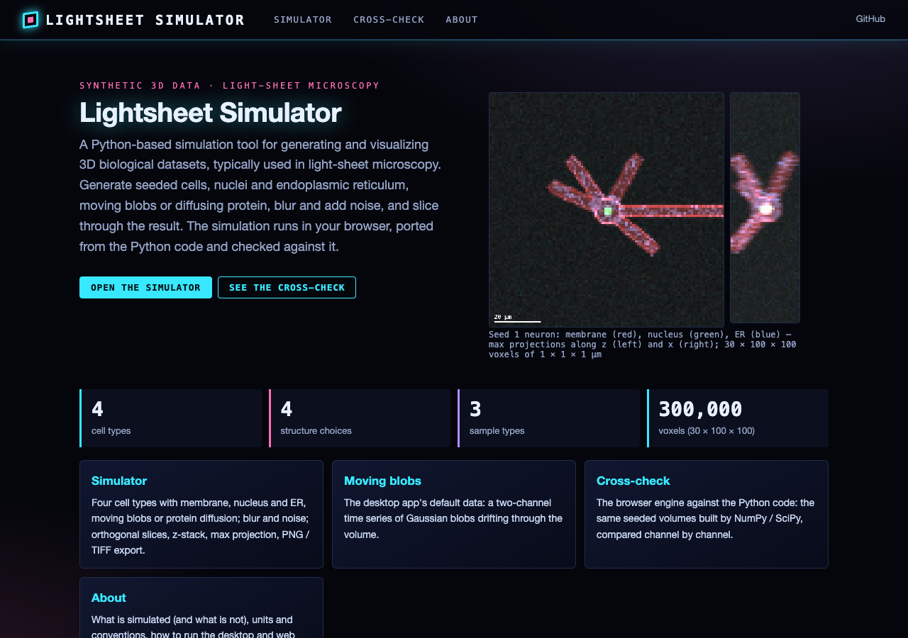
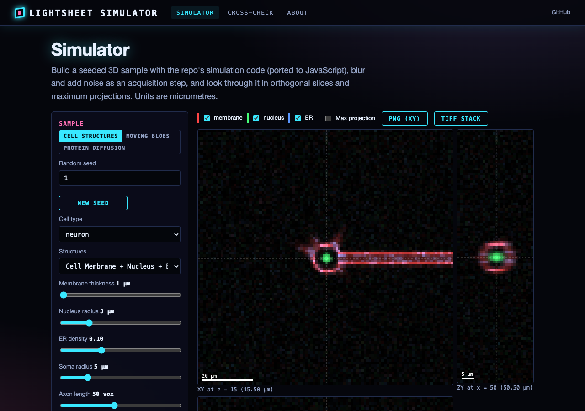
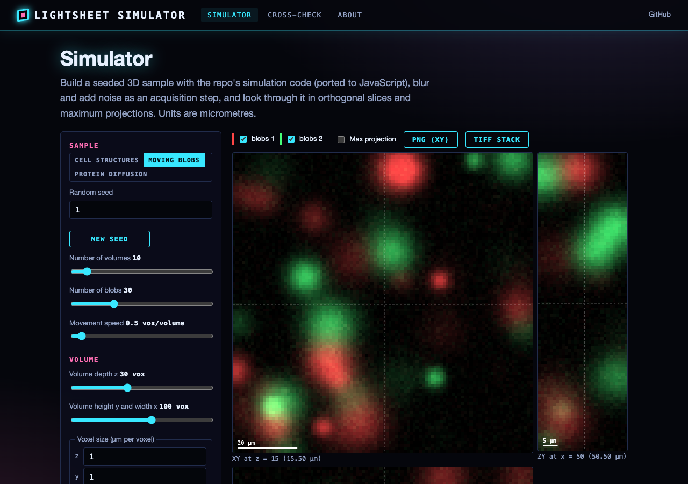
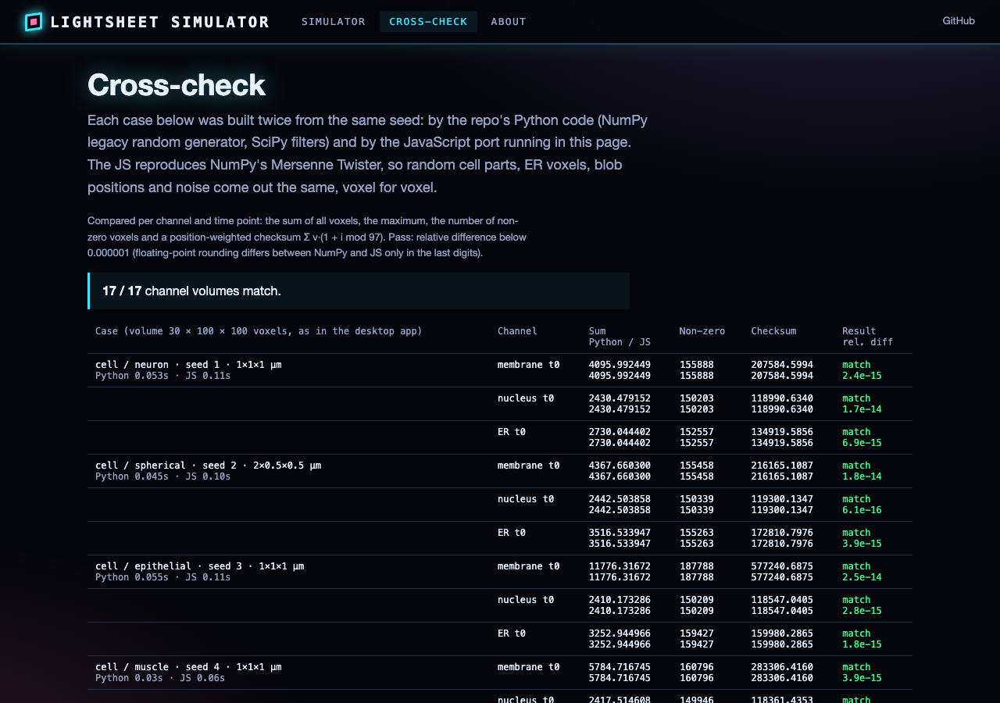

# Biological Light Sheet Data Simulator

A Python application for generating and visualizing synthetic 3D biological datasets, designed for testing and validating light-sheet microscopy analysis pipelines. Features an interactive PyQt5 GUI with real-time 3D rendering via pyqtgraph OpenGL.

## Features

### Biological Simulation (`BiologicalSimulator`)
- **Protein diffusion**: Simulate diffusion using Gaussian filtering with configurable diffusion coefficients
- **Active transport**: Model cargo transport along a simulated cytoskeleton using 3D Bresenham line tracing
- **Cell types**: Generate spherical, neuronal, epithelial, and muscle cells in 3D
- **Organelles**: Create cell membranes, nuclei, and endoplasmic reticulum with adjustable density parameters
- **Calcium signaling**: Simulate dynamic calcium events -- blips, puffs, and propagating waves

### Data Generation
- **Synthetic volumes**: Create multi-channel 3D volumes and time-series with configurable moving intensity blobs
- **Light-sheet simulation**: Simulate angular recordings by rotating volumes and applying back-rotation correction
- **Blob analysis**: Detect blobs using Laplacian of Gaussian (scikit-image `blob_log`) with nearest-neighbor distance calculations via `scipy.spatial.cKDTree`
- **Volume processing**: Thresholding, statistical analysis, and distance transforms

### Interactive GUI
- **Parameter controls** (`BiologicalSimulationWidget`): Tabbed interface for adjusting simulation parameters in real time -- cell radius, axon length, ER density, diffusion coefficient, and more
- **3D rendering**: High-performance OpenGL visualization of generated volumes using `pyqtgraph.opengl`
- **Lightsheet viewer** (`LightsheetViewer`): Main window with 2D slice viewing, rotation controls, and blob detection overlay

### Export
- **TIFF stacks** (`.tif`): Multi-page stacks compatible with ImageJ/Fiji
- **NumPy arrays** (`.npy`): For fast loading in Python pipelines

## Architecture

The simulation code is split into Qt-free modules (`simulator.py`, `data_generator.py`, `structure_pipeline.py`,
`sim_params.py`, `utils.py`) and a PyQt5 GUI package (`gui/`). The original single-file application
`simulateLightSheetData.py` (~2900 lines, its own copies of the classes) is still the entry point that `python
simulateLightSheetData.py` launches. See [`INTERFACE.md`](INTERFACE.md) for the module map.

| Class | Purpose |
|---|---|
| `BiologicalSimulator` | Cell shapes, membrane, nucleus, ER, protein diffusion (calcium and transport are stubs) |
| `DataGenerator` / `VolumeProcessor` | Moving-blob time series, angular-recording rotation, filtering, TIFF/NPY I/O |
| `BiologicalSimulationWidget` / `BiologicalSimulationWindow` | Parameter form for the biological simulation |
| `LightsheetViewer` | Main window with XY/XZ/YZ slices, 3D view, blob detection and playback |

## Requirements

- Python 3.x
- NumPy
- SciPy
- matplotlib
- scikit-image
- tifffile
- PyQt5
- pyqtgraph (with OpenGL support)

## Installation

```bash
pip install numpy scipy matplotlib scikit-image tifffile PyQt5 pyqtgraph PyOpenGL
```

## Usage

```bash
python simulateLightSheetData.py
```

This launches the simulation GUI where you can:

1. Select a cell type and configure structural parameters (radius, membrane thickness, etc.)
2. Set up dynamic simulations (diffusion coefficient, number of time points)
3. Generate synthetic 3D volumes and visualize them in the OpenGL viewer
4. Run blob detection and nearest-neighbor analysis on generated data
5. Export results as TIFF stacks or NumPy arrays

## GUI Framework

Built with **PyQt5** and **pyqtgraph.opengl** for 3D rendering.

## Key Dependencies

| Category | Libraries |
|---|---|
| GUI | PyQt5, pyqtgraph |
| Image processing | scikit-image, scipy.ndimage, tifffile |
| Spatial analysis | scipy.spatial (cKDTree), scipy.spatial.transform |
| Visualization | matplotlib (for 2D plots), pyqtgraph.opengl (for 3D) |


## Web interface and static site

The simulator also runs in the browser: **https://gddickinson.github.io/lightsheet_simulator/** (published by
`.github/workflows/pages.yml` on every push to `main`).

- **Simulator**: seeded cells (spherical, neuron, epithelial, muscle) with membrane, nucleus and ER, the moving-blob
  time series, or protein diffusion; an acquisition step (Gaussian blur with sigma in µm per axis, additive Gaussian
  noise); XY / XZ / ZY slices, plane and time sliders, max projection, PNG of the XY view and an ImageJ TIFF stack with
  the voxel size in the file. Units are µm throughout (voxel size in µm per voxel, z, y, x).
- **Cross-check**: the same seeded volumes built by the Python code and by the JS port, compared channel by channel.
  The JS reproduces NumPy's legacy Mersenne Twister, so the volumes agree voxel for voxel (to rounding).
- The JS engine (`web/static/np_random.js`, `ndimage.js`, `cells_engine.js`, `dynamics_engine.js`, `pipeline.js`)
  is tested against fixtures computed by the Python code (`node web/static/engine.test.mjs`).






### Run the web app

```bash
pip install -r requirements-web.txt
python run_web.py                    # http://127.0.0.1:8204
python -m pytest -q tests            # desktop + web tests
python scripts/build_static.py       # static site in site/
```

---
*Built with AI assistance from [Claude (Anthropic)](https://claude.com/).*
